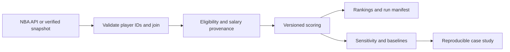

# NBA Value Lab

**A reproducible sports analytics project for investigating player value—and testing how much a ranking depends on its assumptions.**

[](https://github.com/joebakken21/nba-underrated-score/actions/workflows/ci.yml)

[Read the case study](docs/RESULTS.md) · [Methodology & model card](docs/METHODOLOGY.md) · [Data dictionary](docs/DATA_DICTIONARY.md)


## The question

Which NBA players contribute efficiently relative to their modeled investment, and how robust is that shortlist to alternative assumptions?

This project turns NBA Stats data into an inspectable player-value heuristic. It combines efficiency, workload, and multi-category production, then adjusts for salary and opportunity proxies. **The current case study uses estimated salaries; it does not establish that players are underpaid or overlooked.** The original repository name reflects the motivating question, not a validated outcome.

## What the project demonstrates

- **Data engineering:** three NBA endpoints, validated one-to-one player joins, explicit eligibility, bounded request retries, and offline snapshots with SHA-256 integrity checks.
- **Statistical reasoning:** nine matched-cohort scenarios, rank correlations, shortlist overlap, simple baselines, and an explicit separation between sensitivity and predictive validation.
- **Research communication:** a reproducible case study, source/units dictionary, documented assumptions, and a concrete plan for out-of-time evaluation.
- **Software quality:** a modular Python package and CLI, 17 offline tests, lint/format checks, and a GitHub Actions matrix for Python 3.11–3.13.

## Results you can inspect

The committed **2025–26 regular-season snapshot** contains 582 player records. The default screen retains **350 players across 30 teams** with at least 20 games and 15 minutes per game.

- Correcting a fractional-percentage scaling bug changes **4 of the top 20 candidates** relative to the original defensive calculation.
- Uniformly increasing or decreasing estimated salaries by 20% leaves top-20 membership unchanged. This does not establish robustness to player-specific salary errors.
- The score's rank correlation with points per game is **−0.505**, highlighting how much the denominator changes the ordering.

See the [case study](docs/RESULTS.md) for the complete comparison table, leading candidates, and interpretation. These are descriptive findings from one snapshot, not predictive accuracy or causal effects.

## Reproduce in a few commands

Python **3.11+** recommended. From a cloned repository:

```sh
python -m venv .venv
```

Activate with `.venv\Scripts\Activate.ps1` in Windows PowerShell, or `source .venv/bin/activate` on macOS/Linux. Then:

```sh
python -m pip install -r requirements.txt
python -m nba_value --snapshot data/snapshot --sensitivity
python -m unittest discover -s tests -v
```

The first command installs pinned top-level dependencies. The second runs entirely offline using real, committed NBA statistics. Output goes to `results/` and includes rankings, intermediate components, scenario ranks, sensitivity summaries, and a run manifest.

To install the CLI and development tools:

```sh
python -m pip install -e '.[dev,plots]'
nba-value --snapshot data/snapshot --sensitivity
python scripts/build_case_study.py
ruff check .
ruff format --check .
```

`requirements.txt` records the top-level versions used for the case study; it is not a full transitive lockfile. Runtime versions and input hashes are recorded in each run manifest.

## Use fresh data or supplied salaries

```sh
# Fetch the selected season; save the input snapshot with the results.
python -m nba_value --season 2025-26 --sensitivity --output-dir results/live

# Apply stricter sample-size screens to the fixed snapshot.
python -m nba_value --snapshot data/snapshot --min-games 40 --min-minutes 20

# Use season-specific, source-backed annual USD salaries.
python -m nba_value --snapshot data/snapshot --salary-file salaries.csv --sensitivity
```

Salary CSV schema: `PLAYER_ID,SEASON,SALARY,SOURCE_URL`. Every eligible player needs a valid salary for the chosen season. Missing coverage and duplicate keys fail explicitly; supplied salaries are never silently mixed with estimates. The committed case study does **not** include verified contract data.

For Spyder, open the cloned repository as your working directory and run `nba_underrated_score.py`. It delegates to the same package. Use the terminal command above for a guaranteed offline run.

## Design



| Location | Responsibility |
| --- | --- |
| `nba_value/data.py` | API retrieval, snapshots, and integrity checks |
| `nba_value/scoring.py` | Pure validation and scoring transformations |
| `nba_value/diagnostics.py` | Matched-cohort sensitivity comparisons |
| `nba_value/cli.py` | Pipeline orchestration and run provenance |
| `nba_value/export.py` | CSV exports and console summaries |
| `data/snapshot/` | Real season inputs and their manifest |
| `scripts/build_case_study.py` | Regenerate the figure and findings |
| `tests/` | Numerical, boundary, contract, and snapshot integration tests |

## Modeling choices that matter

Production weights are 40% efficiency, 35% role/workload proxies, and 25% multi-category contribution. Investment weights are 50% salary, 30% opportunity, and 20% recognition proxy. These are transparent **analyst choices**, not learned parameters. The score includes caps, floors, and performance penalties; see the [full specification](docs/METHODOLOGY.md).

The most consequential limitations are circular salary estimates, correlated inputs, noisy defensive shooting measures, and unmodeled position/team context. No out-of-time prediction or independent measure of recognition has been evaluated. The next experiment is to add verified salaries, declare an external outcome, and benchmark the frozen model on later seasons.

## Reproducibility and operations

- Live requests were verified during project preparation; future NBA service availability is not guaranteed.
- CI runs without NBA network calls after dependency installation.
- Missing optional values are flagged; invalid required inputs are excluded and counted.
- `--model legacy` reproduces the old defensive scale for comparison; it retains current validation rules.
- Existing output files with matching names are overwritten; use a fresh output directory when comparing cohorts.
- Snapshot hashes are sensitive to line endings; `.gitattributes` preserves LF for CSV/JSON files.

## Attribution

Statistics originate from [NBA Stats](https://www.nba.com/stats) through the community-maintained [nba_api](https://github.com/swar/nba_api) client. This is an independent portfolio research project, not affiliated with or endorsed by the NBA. Snapshot provenance is documented in [data/README.md](data/README.md). No broad reuse license is asserted for third-party data.
