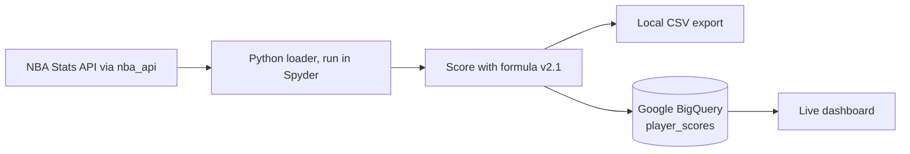
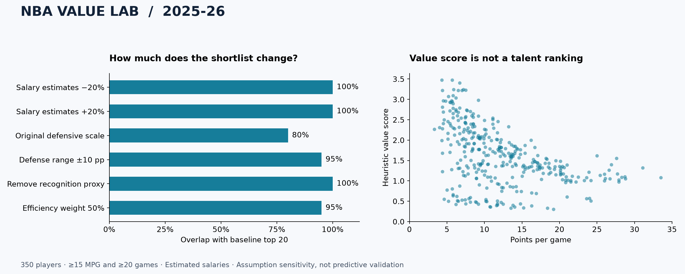

# NBA Underrated Score

**A live analytics pipeline that scores every NBA player on production per unit of investment, loads the results to Google BigQuery, and powers a broadcast-style dashboard.**

[](https://github.com/joebakken21/nba-underrated-score/actions/workflows/ci.yml)


[Methodology](docs/METHODOLOGY.md) · [Data dictionary](docs/DATA_DICTIONARY.md) · [2025–26 research case study](docs/RESULTS.md) · [Changelog](CHANGELOG.md)

## 34 of 172 qualified players rate as Seriously Underrated in the 2026–27 season

The November 11, 2026 load scored **407 players across all 30 teams**. **172 players** cleared the qualifying gates for games played, minutes, and production value.

| Tier | Score | Qualified players | Share |
| --- | ---: | ---: | ---: |
| Seriously Underrated | 2.0 and above | 34 | 20% |
| Quietly Valuable | 1.5 to 2.0 | 30 | 17% |
| Fairly Rated | 1.0 to 1.5 | 57 | 33% |
| Properly Rated | below 1.0 | 51 | 30% |

### The current leaders are efficient rotation players on modest investment

| Rank | Player | Team | GP | MPG | Score |
| ---: | --- | --- | ---: | ---: | ---: |
| 1 | Alex Caruso | OKC | 8 | 18.4 | 3.83 |
| 2 | Ryan Kalkbrenner | CHA | 11 | 18.8 | 3.83 |
| 3 | Ryan Dunn | PHX | 10 | 17.6 | 3.57 |
| 4 | Josh Green | UTA | 9 | 19.4 | 3.49 |
| 5 | Emanuel Sharp | SAC | 11 | 18.2 | 3.18 |

These are early-season results. Every leader has played 11 or fewer games, so the games-played gate is scaled to the share of the season completed (5 games at this load). Rankings will tighten as samples grow and the gate rises toward its full-season value of 30.

## How the score works

```text
Underrated Score = (Production Value x Performance Penalty) / max(Investment Index, 5)
```

- **Production Value (0–100):** 35% efficiency, 30% role difficulty, 35% versatility.
- **Investment Index (0–100):** 40% financial cost, 35% usage, 25% recognition.
- **Performance Penalty:** multiplies the score by 0.30, 0.60, or 0.80 for poor net rating or true shooting.
- **Qualifying gates:** 30 games over a full season (scaled to games played so far), 15+ minutes per game, and Production Value of 50+.

A high score identifies a player who produces more than his salary, usage, and recognition would predict. The full component weights, approximations, and limitations are in the [methodology](docs/METHODOLOGY.md).

## Pipeline architecture



| Stage | What happens |
| --- | --- |
| **Extract** | Pulls per-game, advanced, defensive, touches, on/off, roster, and award data for one season from the NBA Stats API, with retries, pacing, and a same-day cache. |
| **Transform** | Joins one row per player, scales each component 0–100 by percentile, applies the v2.1 weights, penalty, tiers, and qualifying gates, and records every approximation on each row. |
| **Load** | Replaces the selected season's rows in BigQuery with a single `WRITE_TRUNCATE` load job, keeps other seasons intact, and runs on BigQuery's free tier without DML. |
| **Serve** | The dashboard queries the BigQuery table directly with read-only SQL. |

The loader is [`pipelines/11-11-2026-nba-underrated-score-loader-spyder.py`](pipelines/11-11-2026-nba-underrated-score-loader-spyder.py). It is organized as Spyder cells (`# %%`), keeps every setting in one cell, and stops with a plain-language explanation for each known failure: missing packages, NBA API timeouts, empty seasons, unreadable input files, Google Cloud sign-in, and BigQuery permission or schema errors.

## The live dashboard

The dashboard reads the BigQuery table in real time and presents the results in an NBA broadcast style:

- **Scoreboard KPI cards:** players scored, players qualified, the number-one qualified player, and the share rated Seriously Underrated.
- **Top 25 leaderboard** with team logos and tiers, togglable between qualified players and all players.
- **Production vs. investment scatter plot:** underrated players sit high and to the left.
- **Team hidden-value chart:** which rosters hold the most underrated production.
- **Methodology panel** documenting formula v2.1, the gates, the data sources, and the limitations.

The dashboard is hosted privately. A walkthrough is available on request.

## Run the live pipeline

1. Install the packages from **Anaconda Prompt**, using the Anaconda install that Spyder runs. Spyder's console rejects `%pip`.

   ```sh
   python -m pip install nba_api pandas numpy google-cloud-bigquery pyarrow db-dtypes
   ```

2. Sign in to Google Cloud once:

   ```sh
   gcloud auth application-default login
   ```

3. Open the loader in Spyder, set `PROJECT` to your Google Cloud project ID in the SETTINGS cell, and press F5. Set `DRY_RUN = True` to score and save the CSV without touching BigQuery.

The NBA Stats API often blocks cloud and data-center networks, so run the loader from a home or personal network.

## Research edition: a reproducible 2025–26 case study

The repository also contains the earlier research build of this project (model v2), designed to test how much a ranking depends on its assumptions.

- **Data engineering:** three NBA endpoints, validated one-to-one player joins, explicit eligibility, bounded request retries, and offline snapshots with SHA-256 integrity checks.
- **Statistical reasoning:** nine matched-cohort scenarios, rank correlations, shortlist overlap, and simple baselines.
- **Software quality:** a modular Python package and CLI, 17 offline tests, lint and format checks, and a GitHub Actions matrix for Python 3.11–3.13.

Key findings from the committed 2025–26 snapshot (350 qualified players):

- Correcting a fractional-percentage scaling bug changes **4 of the top 20 candidates**.
- Scaling every estimated salary by 20% in either direction leaves **top-20 membership unchanged**.
- The score's rank correlation with points per game is **−0.505**, which shows how strongly the investment denominator reorders players.



Reproduce it offline in three commands:

```sh
python -m pip install -r requirements.txt
python -m nba_value --snapshot data/snapshot --sensitivity
python -m unittest discover -s tests -v
```

To install the CLI, development tools, and the live-pipeline packages:

```sh
python -m pip install -e '.[dev,plots,live]'
nba-value --snapshot data/snapshot --sensitivity
python scripts/build_case_study.py
ruff check .
ruff format --check .
```

Fresh data and supplied salaries:

```sh
# Fetch the selected season and save the input snapshot with the results.
python -m nba_value --season 2025-26 --sensitivity --output-dir results/live

# Apply stricter sample-size screens to the fixed snapshot.
python -m nba_value --snapshot data/snapshot --min-games 40 --min-minutes 20

# Use season-specific, source-backed annual USD salaries.
python -m nba_value --snapshot data/snapshot --salary-file salaries.csv --sensitivity
```

Salary CSV schema: `PLAYER_ID,SEASON,SALARY,SOURCE_URL`. Every eligible player needs a valid salary for the chosen season; missing coverage and duplicate keys fail explicitly.

## Repository layout

| Location | Responsibility |
| --- | --- |
| `pipelines/` | Live v2.1 loader: NBA Stats API to BigQuery, built for Spyder |
| `nba_value/data.py` | Research edition: API retrieval, snapshots, and integrity checks |
| `nba_value/scoring.py` | Research edition: pure validation and scoring transformations (model v2) |
| `nba_value/diagnostics.py` | Matched-cohort sensitivity comparisons |
| `nba_value/cli.py` | Pipeline orchestration and run provenance |
| `nba_value/export.py` | CSV exports and console summaries |
| `data/snapshot/` | Real 2025–26 inputs and their manifest |
| `scripts/build_case_study.py` | Regenerates the case-study figure and findings |
| `tests/` | Numerical, boundary, contract, and snapshot integration tests |

## Limitations

- Salaries and All-Star votes are estimated unless source files are supplied, and recognition is approximated from award history.
- Several v2.1 components use stand-ins for data that the NBA Stats API does not expose, such as matchup-by-position defense and box plus-minus. Each row lists the approximations used.
- Early-season samples are small, and net rating reflects team context as well as individual impact.
- No out-of-time validation against an external outcome has been run yet. The next step is to add verified salaries and benchmark frozen scores against later-season results.

## Attribution

Statistics originate from [NBA Stats](https://www.nba.com/stats) through the community-maintained [nba_api](https://github.com/swar/nba_api) client. This is an independent portfolio project, not affiliated with or endorsed by the NBA. Snapshot provenance is documented in [data/README.md](data/README.md). No broad reuse license is asserted for third-party data.
