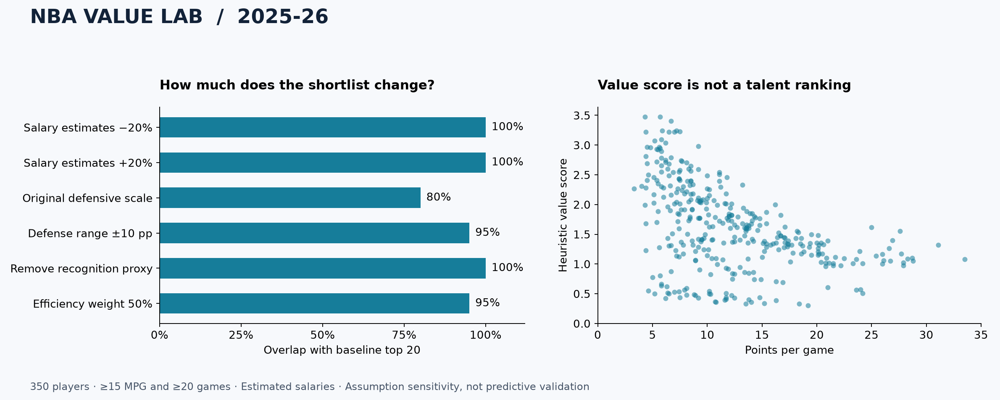

# Case study: 2025-26 player-value screening

**Question:** Which players rise to the top of a transparent production-to-investment heuristic, and how dependent is that shortlist on the assumptions?

This is an exploratory research result using observed NBA statistics and **estimated salaries**. It does not establish that these players are underpaid or overlooked.



## Data and cohort

The snapshot contains 582 player-season rows from NBA Stats. The default filters retain **350 players** across **30 teams**, with at least 20 games and 15 minutes per game. 0 eligible rows failed required scoring validation; 0 required neutral defense values and 0 required neutral PIE values.

Snapshot recorded: `2026-10-06T22:59:31.873860+00:00`. All inputs and SHA-256 hashes are in [data/snapshot](../data/snapshot). This is a fixed regular-season snapshot, not a live ranking.

## What the sensitivity checks show

- Correcting the defensive units changes **4 of the top 20 names** relative to the original defensive scale on this same cohort.
- Scaling every estimated salary by ±20% retains the entire top 20 in both scenarios. This uniform perturbation does **not** test realistic, player-specific salary errors.
- Points per game and the heuristic have a rank correlation of **-0.505**. The investment denominator strongly changes the ordering. This is a warning against describing the output as an overall player-quality ranking.

| Comparison | Rank correlation | Top-20 overlap | Mean absolute rank change |
| --- | ---: | ---: | ---: |
| baseline_v2 | 1.000 | 100% | 0.0 |
| salary_minus_20pct | 0.988 | 100% | 11.5 |
| salary_plus_20pct | 0.999 | 100% | 2.3 |
| legacy_defense_scale | 0.984 | 80% | 13.7 |
| defense_span_10pp | 0.997 | 95% | 6.1 |
| no_recognition_proxy | 0.993 | 100% | 7.3 |
| efficiency_weight_50pct | 0.998 | 95% | 4.8 |
| production_only | 0.122 | 5% | 111.0 |
| points_per_game | -0.505 | 0% | 149.0 |

Rank correlation is Pearson correlation of average ranks (Spearman's rho); ties use average ranks. Top-20 membership breaks exact score ties by player ID. Comparisons share the same cohort. These are assumption scenarios, not confidence intervals or accuracy scores.

## Leading candidates under this heuristic

**Salary values below are model estimates, not player contracts.** Investigate candidates using verified compensation, role, film, and context before making decisions.

| Rank | Player | Team | Games | MPG | Estimated salary | Score |
| ---: | --- | --- | ---: | ---: | ---: | ---: |
| 1 | Mitchell Robinson | NYK | 60 | 19.6 | $2.5M | 3.477 |
| 2 | Josh Green | CHA | 58 | 15.7 | $2.5M | 3.473 |
| 3 | Robert Williams III | POR | 59 | 17.1 | $2.5M | 3.403 |
| 4 | Jaylin Williams | OKC | 65 | 19.7 | $2.5M | 3.243 |
| 5 | Goga Bitadze | ORL | 64 | 15.2 | $2.5M | 3.240 |
| 6 | Jaxson Hayes | LAL | 66 | 18.3 | $2.5M | 3.230 |
| 7 | Mouhamed Gueye | ATL | 77 | 15.3 | $2.5M | 3.223 |
| 8 | Luke Kornet | SAS | 68 | 21.0 | $5.0M | 3.221 |
| 9 | Grant Williams | CHA | 36 | 19.8 | $2.5M | 3.220 |
| 10 | Matisse Thybulle | POR | 30 | 16.0 | $2.5M | 3.093 |

## Interpretation and next experiment

The implementation produces an auditable shortlist and exposes sensitivity to modeling decisions. Its main unresolved weakness is salary estimation from the same minutes and points used elsewhere in the model. The recognition proxy also reuses salary and usage. Apparent value can therefore reflect the model's construction rather than a real market inefficiency.

The next research step is a player-ID-matched, season-specific salary dataset and a predeclared out-of-time evaluation. Freeze features before the evaluation season, compare against simple production/salary and minutes baselines, and assess next-season outcomes with uncertainty and positional subgroup checks. No such predictive evaluation has been performed here.

## Reproduce

```sh
python -m nba_value --snapshot data/snapshot --sensitivity
python scripts/build_case_study.py
```

Install the `plots` optional dependencies for the second command. The run manifest records model settings, eligibility, versions, input hashes, and exclusions. See [methodology](METHODOLOGY.md) and [data dictionary](DATA_DICTIONARY.md).
